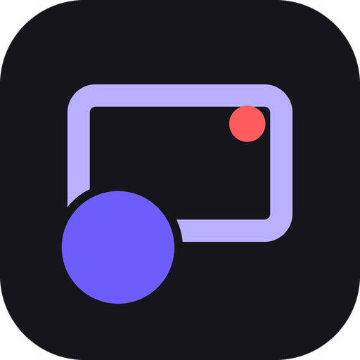

<h3 align="center">Graba — graba tu pantalla y tu IA te deja el guion</h3>

  Pantalla, cámara y voz. Transcribe en tu computador y tu propia IA escribe notas, guion para YouTube, títulos, capítulos y subtítulos. 
  Para Mac, Windows y Linux. Gratis, de código abierto y privado.

  <a href="https://graba-app.github.io/graba/"><b>Descargar</b></a> ·
  <a href="https://github.com/graba-app/graba">Código</a> ·
  <a href="https://github.com/graba-app/graba/discussions">Comunidad</a> ·
  <a href="https://github.com/graba-app/graba/blob/main/CONTRIBUTING.md">Cómo aportar</a>

---

<b>English:</b> free, open-source screen recorder with your camera. Local transcription, your own AI writes notes, a YouTube script, chapters and subtitles. For Mac, Windows and Linux.

